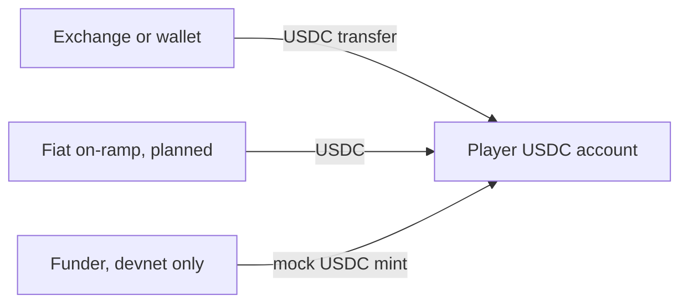
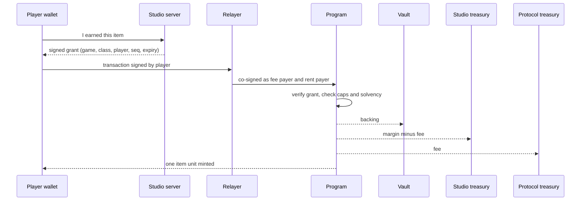

# Flow of money

Every path a dollar can take through PixelVault, who signs for it, who pays the network, and what can never happen. Amounts are USDC base units unless stated (1 USDC = 1,000,000). Instruction names are the program's.

## 1. Accounts and who controls them

| Account | Holds | Controlled by | Can money leave it? |
|---|---|---|---|
| Player wallet (embedded, Privy) and its USDC account | the player's USDC | the player's key; the player never holds SOL | only with the player's signature |
| Game vault, one per game | the backing of every item the game has in circulation | the game's program address (a PDA); no key | only through `redeem`, exactly one unit's backing to the redeeming holder |
| Studio treasury | the studio's margin | the studio's key | yes, it is the studio's money |
| Protocol treasury | protocol fees | the protocol admin (a multisig in production) | yes, it is the protocol's revenue |
| Item accounts (Token-2022), one per player per item class | the items themselves | the player; minting only by the game PDA inside `craft` | burned only in `redeem` |
| Sponsor wallet | SOL for fees and rent | the relayer's hot key | only as fee payer, `craft` rent payer, `open_run` payer or `close_run` refund target; the relayer refuses every other role |
| Run buffer, one per player per track | nothing of value; 2.2 KB of rent while a race is being verified | the program | rent returns to whoever paid it on `close_run` |
| Funder (devnet only) | the mock USDC mint authority | our key | mints test USDC for the starter grant and the faucet; does not exist on mainnet |

The rule the whole design rests on: **no key can move USDC out of a vault.** Not the studio, not the protocol admin, not the relayer, not us. The only instruction that transfers out of a vault is `redeem`, and it pays one unit's backing to the player who burns the unit.

## 2. Money in

**Mainnet:** the player sends USDC to their wallet address from any wallet or exchange (the Vault screen shows the address), or a fiat on-ramp partner delivers USDC to that address (planned). The player needs no SOL at any point.

**Devnet:** `/api/starter` mints 2 test USDC once per Telegram account; `/api/faucet` mints 2 test USDC once per wallet for studios testing an integration. Both refuse to run off devnet.



## 3. Craft: the split

The player has earned the right to craft (materials in the game's database) and pays the price in USDC. The studio's server signs a grant; the program verifies it and splits the price in one transaction.



Exact arithmetic, as `apply_bps` computes it (round down at each step):

```
backing      = price × backing_bps / 10,000
margin       = price − backing
protocol_fee = margin × fee_bps / 10,000       (fee_bps = 1,250; the program refuses anything above 2,500)
studio_cut   = margin − protocol_fee
```

Worked example, Futura chassis, price 1,000,000, backing 9,000 bps:

| Leg | Amount | From | To |
|---|---|---|---|
| Backing | 900,000 | player USDC account | game vault |
| Protocol fee | 12,500 | player USDC account | protocol treasury |
| Studio cut | 87,500 | player USDC account | studio treasury |
| Item | 1 unit | minted by the game PDA | player item account |
| Network fee | 10,000 lamports | sponsor | validators |
| Rent, first time this player holds this class | 2,039,280 lamports | sponsor | player item account (stays with the account) |

Checks the program makes before any of it moves: the grant's signature, signer, game, class, player, sequence number and expiry; the per-player, per-game and global backing caps; the class's supply cap; crafting not paused; and after the transfer, `vault balance ≥ total backing` for the game, or the whole transaction fails.

## 4. Redeem: the refund

The player burns one unit; the program pays that unit's backing from the vault to the player's USDC account. No grant, no server, no studio key, no pause flag.

| Leg | Amount | From | To |
|---|---|---|---|
| Item | 1 unit burned | player item account | nowhere |
| Backing | 900,000 | game vault | player USDC account |
| Network fee | 10,000 lamports | sponsor (or the player, if they have SOL) | validators |

The vault's `total_backed` falls by the unit's backing. The check `vault balance ≥ total backing` runs again after the transfer.

## 5. Route: moving value between games

One transaction, two instructions: `redeem` in game A, then `craft` in game B with a grant from B's server. The backing released by the redeem pays for most of the new item; the player's USDC account covers the difference, if any.

Worked example, Cyan Pulse (Neon Racer, backing 210,000) into Neon Frame (Glyph Forge, price 500,000, backing 8,000 bps):

| Step | Player USDC account | Neon Racer vault | Glyph Forge vault | Glyph studio treasury | Protocol treasury |
|---|---|---|---|---|---|
| Before | 1,000,000 | 210,000 | 0 | 0 | 0 |
| Redeem Cyan Pulse | 1,210,000 | 0 | | | |
| Craft Neon Frame | 710,000 | | 400,000 | 87,500 | 12,500 |
| Net | −290,000 | −210,000 | +400,000 | +87,500 | +12,500 |

The player paid 290,000 for a 500,000 item, because 210,000 of its price was value they already held. Both legs are in one transaction: if the craft fails, the redeem is rolled back too.

## 6. Withdraw: money out

A USDC `TransferChecked` from the player's account to any Solana address. The relayer pays the fee for it when the amount is at least 100,000 (ten cents), the transfer is alone in its transaction, and the authority is the caller's own wallet; the destination must already have a USDC account, so the sponsor never pays rent for a stranger. Withdrawals need nothing from any studio.

## 7. Verified races: SOL only

A race costs the player nothing. The relayer pays about seven transactions (open and upload the inputs, several replay steps with a raised compute limit, close) and the run buffer's rent, which comes back to the sponsor on `close_run`. The relayer refuses priority fees, any other program, and the sponsor key in any role but payer and refund target. Rewards for a verified race are materials in the game's database, never USDC.

## 8. Raising backing

A studio may raise an item class's backing ratio. The program computes the difference for every unit already in circulation and transfers it from the studio's USDC account into the vault in the same instruction; it refuses any ratio that is not strictly higher. Backing can never be lowered.

## 9. Treasuries out

| Treasury | Spent on | By whom |
|---|---|---|
| Studio treasury | whatever the studio likes; it is their revenue | studio key |
| Protocol treasury | audit, infrastructure, sponsored fees for pilot studios, team | protocol admin (multisig); a spending policy is published before mainnet |
| Sponsor wallet | fees and rent | topped up by the protocol or, for a self-hosted studio, by the studio |

## 10. The invariants, as money statements

1. **Every vault covers what it owes.** `vault balance ≥ total_backed` is asserted after every craft, redeem and backing raise. The solvency page re-reads the balances from the chain and shows this for every game.
2. **A unit's refund never falls.** `backing_per_unit` can only rise.
3. **Redemption cannot be stopped.** `redeem` reads no pause flag and needs no server. The admin's pause stops crafting only; a studio's pause stops its own crafting only.
4. **Backing earns nothing and is lent to no one.** There is no instruction that moves vault USDC anywhere but to a redeeming holder. This is what keeps the vault fully reserved rather than fractional.
5. **Exposure is capped during launch.** $25 backing per player per game, a per-game cap set at registration, a global cap set by the admin.

## 11. What happens when things go wrong

| Event | Player's money |
|---|---|
| Studio shuts down, server gone | items still redeem for their backing; crafting stops (no grants); routing into that game stops |
| Protocol operators disappear, relayer offline | items still redeem; the player needs a little SOL or any other relayer to pay the fee; the program needs no server |
| Relayer key stolen | attacker can spend the sponsor's SOL on fees and rent for players, and nothing else: it cannot act as a player, cannot touch USDC |
| Studio grant key stolen | attacker can authorise crafts for that game; every craft still costs the player's USDC and locks backing; the studio rotates the key with `update_game` |
| Admin key stolen | attacker can pause crafting, raise the fee to at most 25% of margin, and change caps; cannot touch backing; the role moves to a multisig before mainnet |
| USDC itself fails | backing is USDC; the player's refund is in USDC; this risk is disclosed and is why a multi-stablecoin option is on the roadmap |

## 12. Custody posture, for the lawyer

The vault is a token account owned by a program-derived address. No private key corresponds to it. The program's code is the only thing that can move funds out of it, and the only instruction that does so pays a holder who burns an item. PixelVault the company never holds, pools, lends or directs user funds; it holds a fee treasury (its own revenue) and a SOL wallet for network fees. The studio holds its own margin. The player holds their own USDC and items in a wallet whose key only they can use. This document is the technical basis for a legal opinion; it is not one.
